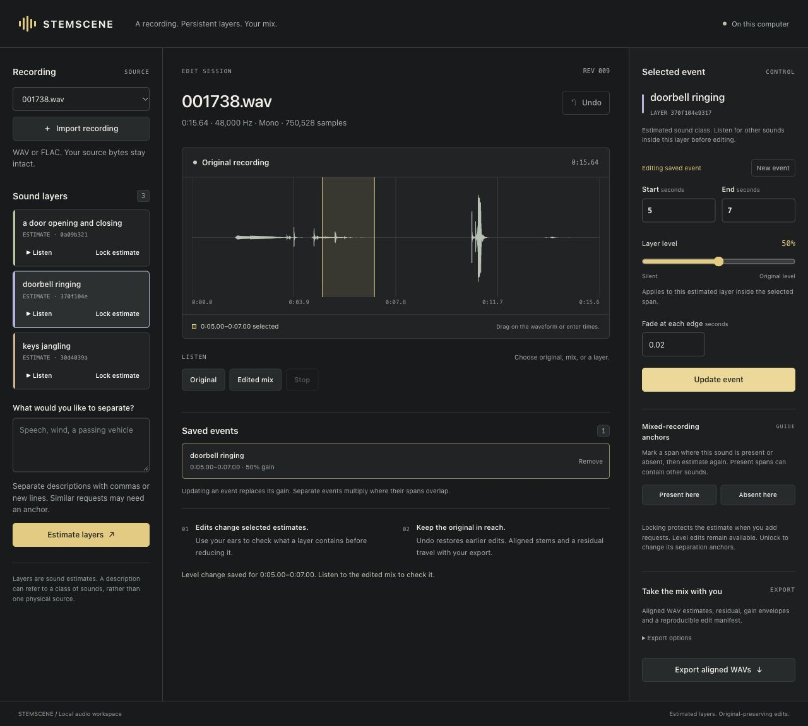

# STEMSCENE

STEMSCENE turns an authorized mono recording into persistent **estimated sound layers**, lets you change selected events, and exports aligned WAVs with an independently reproducible mix. The browser mixer, Python API and CLI use the same installed local engine.

A layer is an estimate of a sound class. It can contain leakage, miss a quiet event or share energy with another description. It is not proof that one physical source was isolated.

**Experimental beta, 0.1.0b1.** Actual local inference, a trained 579-parameter refiner, browser editing and independent WAV replay have been exercised. On the frozen 20-scene study, trained refinement reduced mean all-request edit error by **7.25%** versus the strongest comparable non-oracle baseline. However, **29 of 60 individual edits worsened**, target gain accuracy declined and **five of six absent requests falsely extracted audio**. This is a bounded edit-integrity result, not a general separation-quality or scientific-novelty claim. See [all comparisons and failures](docs/comparisons.md).



[Watch the 23-second actual-session walkthrough](docs/demo/assets/stemscene-walkthrough.mp4) or open the [audio comparison and credits](docs/demo/index.html). The walkthrough uses captured session states and actual original/edited audio; inference waiting is omitted.

## Use it

With Python 3.11 or 3.12 and [uv](https://docs.astral.sh/uv/) installed, run from this checkout:

```sh
uv sync --locked --python 3.12
uv run --locked stemscene models download "$HOME/.local/share/stemscene/models"
uv run --locked stemscene serve \
  --workspace "$HOME/.local/share/stemscene/workspace" \
  --checkpoint "$HOME/.local/share/stemscene/models/audiosep_base_4M_steps.ckpt" \
  --tokenizer-dir "$HOME/.local/share/stemscene/models/roberta" \
  --port 0
```

The bundled V1 refiner is the frozen beta artifact. Open the printed `127.0.0.1` URL. Import WAV/FLAC, request sound descriptions, listen to the estimates, select an event span and change its level. Revise a saved event without stacking another attenuation. Lock an estimate before adding requests that must not change it. Undo restores the preceding saved state.

Setup downloads approximately **1.27 GB** of pinned public model/tokenizer/license files into a **new** directory. Normal extraction does not download models or upload recordings. CPU is the default. For optional tested Apple MPS execution, prefix the command with `PYTORCH_ENABLE_MPS_FALLBACK=1` and add `--device mps`; some operations require CPU fallback. Set that environment variable before starting Python, including when using the API. SAM Audio is not required.

See the [complete quickstart](docs/quickstart.md) for CLI editing, anchors, export, offline replay and the Linux CPU installation route. The [Python API](docs/python-api.md) uses the same engine.

## What an export contains

| File | Purpose |
| --- | --- |
| Preserved source file | Original imported bytes and SHA-256 |
| `original-decoded.wav` | Decoded original at its declared rate and channel count |
| `stems/*.wav` | Aligned estimated components with stable layer IDs |
| `residual.wav` | Original minus the sum of estimates |
| `envelopes/*.wav` and JSON recipes | Applied gains, exact sample spans and inside-span fades |
| `mix.wav`, `manifest.json` | Rendered edit, processing metadata, checksums and measured round-trip errors |

The edit equation is `original + sum((gain_envelope - 1) * estimated_stem)`. Samples outside selected edit spans remain untouched in the decoded render. Export verifies the actual written WAVs before publishing the output folder. Default DOUBLE WAV has a maximum absolute round-trip tolerance of `1e-12`; FLOAT uses `1e-6`. Incompatible numerical cancellation or quantization is rejected. Reconstruction is a contract check, not a separation score.

An independent replay needs NumPy and soundfile, but no engine or model:

```sh
python examples/recombine.py /path/to/export-or.zip --output replay.wav
```

## Method and evidence

AudioSep supplies text-conditioned proposals from the unchanged mixed recording. A compact trained query-set refiner uses proposals, mixture features and optional user anchors. Persistent class identities, locks, explicit residuals and original-based gain edits connect those estimates to a production workflow. Text prompts, chunking, anchors and mixture consistency are established methods, not claimed inventions.

The controlled pilot uses licensed genuine ESC-10 recordings with source/uploader/recipe separation. Its generated mixtures are **controlled mixtures of recordings**, not naturally captured multitrack truth. Clean references and presence labels are training/evaluator-only. A separate RealDESED recording has been used for natural-scene operation; it has no clean stems and is outside the refiner's ESC-10 training domain.

The final candidate, edit protocol, scalar controls and thresholds were frozen before confirmation. Trained mean edit NMSE was 0.0441843 versus 0.0476391 for fixed 0.75 proposal scaling, with 16/20 scene wins but only 31/60 individual-request wins. Direct SDR fell from 3.606 to 3.145 dB versus independent extraction, and target gain error rose from 0.226 to 0.472. Sequential reverse extraction beat trained refinement in 12/20 scenes despite its worse mean. Source reuse leaves only five connected scene groups; no statistical confidence or listening-quality claim follows. The [model card](docs/model-card.md) records training, provenance and intended use.

An independent non-editable wheel installation downloaded fresh public models and a different natural recording, ran three-query CPU inference, and independently replayed its exported edit. It took 328.28 seconds including model load, with 3.20 GiB peak process RSS on the tested Mac. A separate 48-second development mixture exercised long refinement, locks, order, cancellation, silence and boundaries; [its failures and measurements](docs/long-audio.md) remain part of the result.

- [Audio contract](docs/audio-contract.md)
- [Foundations and prior-work scope](docs/foundations.md)
- [Frozen confirmation and failures](docs/comparisons.md), [long-audio stress](docs/long-audio.md), and [installation evidence](docs/verification.md)
- [Refinement method](docs/refinement-method.md) and [v2 experiment](docs/refinement-v2.md)
- [Frozen data protocol](docs/data-protocol.md) and [metric definitions](docs/evaluation-metrics.md)
- [Sequential comparison](docs/sequential-comparison.md) and [FUSS comparison](docs/fuss-comparison.md)
- [Editable architecture](docs/architecture.md), with [Mermaid source](docs/architecture.mmd)

## Limits

- Learned separation is **mono only**. The core can edit/export stereo arrays; that is not evaluated stereo separation.
- This is offline processing with full-clip context, not causal or live streaming.
- The admission ceiling is 600 seconds and eight requested classes, with additional byte and time bounds. That ceiling is not a claim of measured quality over every admitted length.
- Similar descriptions and indistinguishable sources may need grouping or anchors. Automatic prompt-overlap warnings missed tested near-synonyms, so users must review and group descriptions themselves. Similarity is not isolation confidence. Locked stems cannot silently change; incompatible requests or changed anchors produce a conflict.
- There is no hidden loudness normalization or speech regeneration. Peak policy is explicit; hard clipping is rejected if it would alter unedited original samples.
- No human listening-panel or general speech/wind/vehicle quality claim has been established. Review estimates before attenuating them.

The local test machine had 32 GiB memory and ten CPU cores. That is an observed machine, not a verified minimum requirement. Cold loading, warmed inference, MPS fallback, clip length and shared machine load affect performance.

## Development

```sh
uv sync --locked --extra test --python 3.12
uv run --locked --extra test python -m pytest -q
```

Correctness CI uses CPU PyTorch and exercises the installed CLI, alignment, edits, locks, undo, malformed inputs, memory admission and refiner invariants. It does not download the large checkpoint or replace real local-inference verification with synthetic fixtures.

## Attribution

Original STEMSCENE code is [MIT](LICENSE). Retained AudioSep and Torchlibrosa code keeps its own MIT notices. The optional FUSS adapter is [Apache-2.0](LICENSES/Apache-2.0.txt); its deposited checkpoint has separate CC BY 4.0 terms. Model-host and code licenses are recorded separately. See [third-party notices](THIRD_PARTY_NOTICES.md) before redistributing code, models or examples.

The retained Apache text is byte-identical to the [official FUSS repository license](https://raw.githubusercontent.com/google-research/sound-separation/master/LICENSE), SHA-256 `cfc7749b96f63bd31c3c42b5c471bf756814053e847c10f3eb003417bc523d30`.
