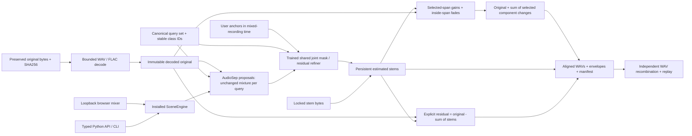

# Engine and reproducible edit path

The browser and CLI call the same installed `SceneEngine`. Processing uses ordinary authorized recordings and explicit local model files. No clean references, presence labels, remote model service or visual sensors enter production inference.

The editable source is the Mermaid block above. `architecture.mmd` contains the same graph for diagram tools.

Activity and overlap diagnostics help reveal uncertain associations. A stable query-class ID does not prove that one physical source was tracked. Similar or indistinguishable requests may require grouping or a useful anchor. The explicit residual preserves unresolved energy without forcing every requested description to own part of the mixture.

Training and evaluation are separate utilities. They can open clean source references for loss and scoring; the installed inference API cannot accept them. Frozen recipe and source hashes connect those records to the reported experiment. Reconstruction accuracy and separation accuracy are reported separately.
