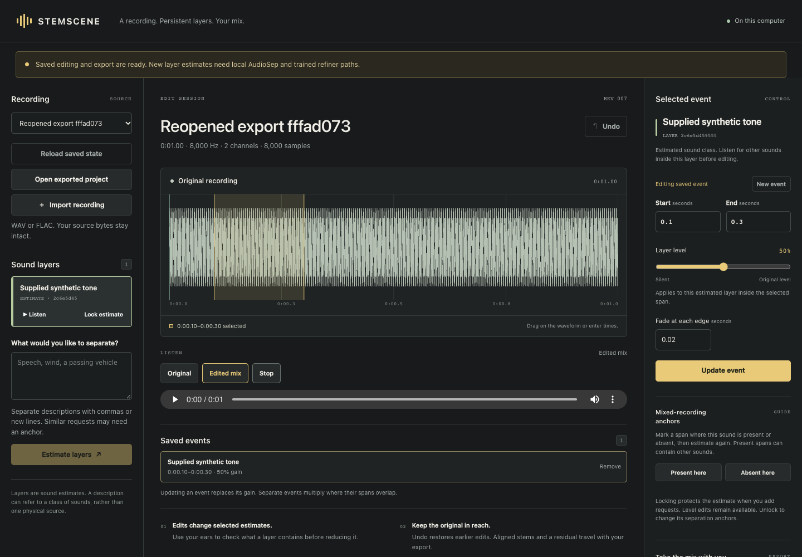

# Revise a saved event, retain the recording

Actual current-main journey, `bd396be42e63bfb89b84ec7773aa944609d58b62`. This is synthetic editing evidence, not new source-separation inference, training, a listening test or physical-source identification. The supplied estimate is exactly `0.6 × original`; that fact is a fixture construction, not an estimated accuracy result.

The browser reopened the repository's synthetic editable fixture, selected its saved 0.10–0.30 s event and updated the layer level from 25% to 50%. The same event ID remained, with one saved event rather than another multiplied operation. Undo restored 25%; the final update returned to 50%. Invalid end time 2 s was refused without changing the saved event. Reload restored the saved controls. Empty file selection and a malformed ZIP preserved the opened project. The exported project reopened in a fresh browser and through the actual CLI/API.

## What the visual encodes

[Desktop SVG](event.svg) · [phone SVG](event-mobile.svg) · [all 8,000 sample rows](samples.csv) · [generator](figure.py) · [audio check](audio-check.json) · [file hashes](figure-manifest.json).

The first plot includes every gain sample over the full one-second recording. Dashed is the prior 25% event; solid is the revised 50% event. The selected half-open sample span is `[800, 2400)` at 8 kHz. Both 160-sample linear-amplitude fades remain inside it. Updating replaces the event's gain instead of stacking another attenuation.

The second plot is explicitly a different x scale: a left-channel sample zoom from 0.09 to 0.14 s, straddling the start of the edit. Every sample in that disclosed zoom is included. Dashed is original; solid is the actual exported DOUBLE WAV. Both share the same amplitude scale. The vertical marker is 0.10 s. This is linear decoded sample amplitude, not perceived loudness. The right channel is retained in the CSV and checked, but not drawn. No smoothing, normalization, resampling or denoising is applied.

The independent equation is `mix = original + (gain - 1) × supplied_estimate`. It matches all 16,000 exported channel samples exactly. Every sample before 800 and from 2400 onward is bit-identical to decoded original in both channels. The separately indexed gain recipe agrees within floating rounding reported in audio-check.json. Reconstruction is an edit-integrity check, not isolation confidence.

## Open the actual project

[Download edited-project.zip](edited-project.zip). It includes aligned DOUBLE WAVs, exact source bytes, estimate arrays, original-based gain recipe, stable layer/event IDs and undo history. Every path in its native manifest is included and hash-checked. `figure-manifest.json` also binds every ZIP member. Original synthetic audio and history are intentional parts of this example; review them before sharing any real export.

Using the current source and its declared Python3.11/3.12 core environment, start the model-free editor:

```sh
uv sync --locked --python 3.12
uv run --locked stemscene serve --workspace /absolute/path/to/new-workspace --port 0
```

Open the printed loopback URL, choose **Open exported project**, and select the ZIP. Pick the saved event; edit and Undo. New estimates require the separate optional local model runtime; this route does not download weights. The CLI equivalent, choosing fresh destinations, is:

```sh
uv run --locked stemscene reopen /absolute/path/to/extracted-export /absolute/path/to/new-project
uv run --locked stemscene export /absolute/path/to/new-project /absolute/path/to/new-export
uv run --locked python examples/recombine.py /absolute/path/to/new-export --output /absolute/path/to/new-replay.wav
```

The reopen CLI expects an export directory, so extract the ZIP first and pass that directory to `reopen`. Browser reopening accepts ZIP directly. The actual fresh-extraction CLI and standalone replay commands/results are retained in [audio-check.json](audio-check.json). Original and mix are also available as [original.wav](original.wav) and [mix.wav](mix.wav). Native manifest reconstruction tolerance is distinct from the stronger exact equality observed in this synthetic case. These unsigned records do not authenticate origin or establish general audio quality.

## Actual workspace

<picture>
  <source media="(max-width: 600px)" srcset="editor-mobile.png">
  
</picture>

The product code and deployed web assets remain unchanged; no new usability defect was demonstrated in this bounded journey. Optional inference, GPU execution, full cancellation during a running model and original beta study were not rerun. All original negative results, mono-inference limits, third-party notices and prior-work scope remain in the root README and linked method documentation.
